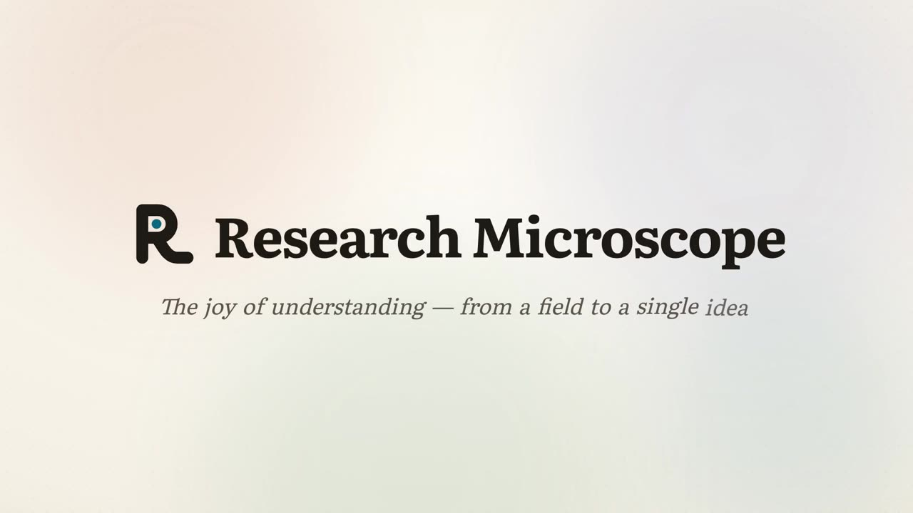
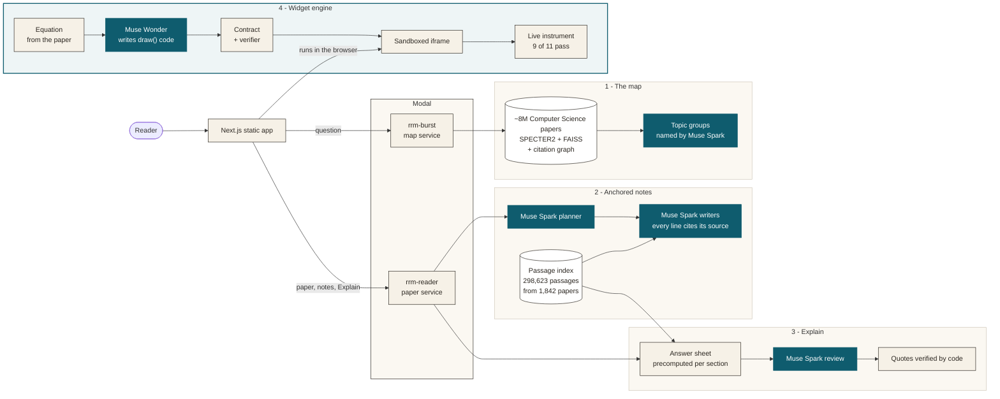

<p align="center">
  <a href="https://youtu.be/NpIZdZCemTY"></a>
</p>

<h1 align="center">Research Microscope</h1>

<p align="center">
  <a href="https://youtu.be/NpIZdZCemTY"><b>▶ Watch the 3-minute demo</b></a> ·
  <a href="#how-it-works">How it works</a> ·
  <a href="#meta-models">Meta models</a> ·
  <a href="#run-it">Run it</a> ·
  <a href="#honest-limits">Limits</a>
</p>

<p align="center">
  
</p>

Ask one research question. Research Microscope draws the field as a map of related papers, takes you into the right paper, and helps you understand it: every symbol is linked to where it's defined, margin notes cite their sources, equations become live figures you can play with, and **Explain** checks your own explanation against the paper.

## The problem

- **The volume keeps growing.** arXiv received a record **40,363** new submissions in September 2026. In September 2016 it received 9,869, so monthly volume has grown about 4× in ten years ([arXiv blog, Oct 2026](https://blog.arxiv.org/2026/10/01/updated-rate-limit-policy/)). Up to **1 in 5** Computer Science abstracts already show LLM-modified text ([Liang et al., *Nature Human Behaviour*, 2025](https://www.nature.com/articles/s41562-025-02273-8)).
- **Reading is where people get stuck.** Most researchers say they can't keep up with the literature ([arXiv:1612.07863](https://arxiv.org/abs/1612.07863)). Readers get stuck on a paper's local terms and symbols: in an observational study, 8 of 9 did ([ScholarPhi, CHI '21](https://arxiv.org/abs/2009.14237)).

Summaries make reading faster, but they don't build understanding. Research Microscope is built for understanding.

## What it does

| | |
|---|---|
<p align="center"></p>

**One question, one map.** Type a question, a title, or a topic, in English or Spanish. You get about 100 related papers, grouped into topics, laid out by year, and numbered in a suggested reading order.

| | |
|---|---|
|  |  |
| **The paper.** Symbols light up wherever they appear. Margin notes have three clearly labelled layers: *From this paper*, *From other papers*, and *AI-generated*. | **Live figures.** An equation becomes a small interactive instrument, written by Muse Wonder under a strict contract and checked before it is shown. |
|  |  |
| **Explain.** Write what you understood. Each claim comes back as *Matches*, *Contradicts*, *No support*, or *You missed*, with a quote from the paper that was checked against its text. | **The engine.** Equation → `draw()` code → a verified, sandboxed widget. |

<sub>Images are frames from the demo video and show *Attention Is All You Need* (Vaswani et al., 2017, [arXiv:1706.03762](https://arxiv.org/abs/1706.03762)). Google grants permission to reproduce the paper's tables and figures for scholarly use with attribution. Paper data: [Semantic Scholar](https://www.semanticscholar.org/).</sub>

## How it works



<sub>Teal: Meta models. Ink: our code. Only verified widgets are shown.</sub>

1. **The map (`rrm-burst`).** The question is embedded with SPECTER2 and searched in a FAISS index of about 8M Computer Science papers from Semantic Scholar. The results are expanded through the citation graph, split into topic groups named by Muse Spark, and laid out on a timeline with a suggested place to start. `pipelines/` builds the corpus and the index on Modal.
2. **Anchored notes (`rrm-reader`).** The reader parses the paper's arXiv source into sections, equations, symbols, and figures, and finds the gaps a newcomer would trip on. A Muse Spark planner decides what each gap needs, and Muse Spark writers fill it with passages from the paper and from a passage index of 298,623 passages from 1,842 papers. Every line is anchored to the text and carries its source: *From this paper*, *From other papers*, or *AI-generated*.
3. **Explain.** When you open a section, an answer sheet with its key points and supporting passages is precomputed. You write your explanation and Muse Spark reviews it claim by claim against that sheet. Every quote it returns is checked against the paper's text by code. **On our test set of 137 hand-written claims, each run 3 times, 99% of verdicts were correct and 98% were stable.**

### The widget engine

An equation from the paper becomes a live instrument. Muse Wonder writes a single JSON object that follows the `rrm-widget` contract: `id`, `topic`, `title`, `explain`, `questions`, `controls`, and a pure `draw(ctx, state, t)` function ([contract](rrm/liveart/CONTRACT.md)). This happens at build time (`scripts/liveart_*`). A verifier checks the code's AST, the control budgets, and its fidelity to the paper. The browser then runs the widget in a sandboxed iframe with no network access. Only verified widgets are shown. **Today, 9 of our 11 widgets pass.**

## Meta models

| Model | Used for | Code |
|---|---|---|
| **Muse Spark** (`muse-spark-1.3-contributor`) | Topic names on the map, the note planner and writers, Explain reviews | `rrm/search/split.py`, `rrm/reader/notes.py`, `rrm/reader/analysis/`, `rrm/reader/explain/` |
| **Muse Wonder** (`muse-wonder-1.0`) | Widget code (`draw()`), at build time | `scripts/liveart_*.py`, `scripts/scripts_live.py`, `rrm/liveart/` |
| **Muse Image** (`muse-image-1.0`) | Concept art for the demo video | video pipeline |

All calls go through the Meta Model API. The reader's calls set `store: false`. Paper notes cover **86%** of what a reader must know (88% on unseen papers), and analyzing a paper costs less than 1 cent.

## Run it

**Option 1: watch it.** The [3-minute video](https://youtu.be/NpIZdZCemTY) shows the full flow on real papers.

**Option 2: local UI, no keys, $0.** This option runs the real UI and a local API on a small synthetic map, with no Modal, Meta, or Semantic Scholar calls. You need Python 3.12 and Node ≥ 22. The script runs `npm ci` itself the first time.

```bash
git clone https://github.com/FrankEBaru/research-microscope && cd research-microscope
RRM_OFFLINE_SYNTH=1 bash scripts/offline.sh      # open http://localhost:3000, Ctrl+C stops it
```

The synthetic data shows the flow (home → map → paper), not real papers.

**Option 3: live, with your own keys (advanced).** This needs a Modal account, `MODEL_API_KEY` (Meta Model API), and `S2_API_KEY` (Semantic Scholar), plus the corpus and index built on Modal with [`pipelines/s2_download/RUN.md`](pipelines/s2_download/RUN.md) and [`pipelines/index_build/RUN.md`](pipelines/index_build/RUN.md). Then:

```bash
RRM_MODE=online bash scripts/run.sh   # deploys rrm-burst and rrm-reader, stops them on exit
```

`RRM_MAX_MINUTES` (default 30) stops the session automatically, and the script never prints keys. The precomputed real-paper data used in our demo is not published, because it contains paper text.

**Checks:** `bash scripts/check.sh` (Python; no network calls to paid services) and `cd apps/reader && npm test`.

## Repository map

| Path | What |
|---|---|
| `apps/reader/` | Next.js static app (the UI) |
| `rrm/search/` | Map service: search, citation graph, topics, layout (`rrm-burst`) |
| `rrm/reader/` | Paper service: parsing, gaps, notes, Explain (`rrm-reader`) |
| `rrm/liveart/` | Widget contract, prompts, verifier |
| `pipelines/` | Semantic Scholar download and FAISS / citation-graph build on Modal |
| `eval/`, `evals/` | Citation recall, prompt and widget evaluations |
| `scripts/` | Run, offline, checks |

## Honest limits

- **Today it covers Computer Science.** The map searches about 8M Computer Science papers from Semantic Scholar.
- **9 of 11 widgets pass verification today.** That number grows as the engine improves.
- **The demo runs on a precomputed set of papers.** Notes, answer sheets, and widgets for those papers are prepared ahead of time, so the demo is fast and costs nothing to show.

## License and attribution

- Code: [MIT](LICENSE).
- Metadata from **[Semantic Scholar](https://www.semanticscholar.org/)** (ODC-BY); papers from [arXiv](https://arxiv.org/), always linked to the source.
- Built with [Next.js](https://nextjs.org/), [KaTeX](https://katex.org/) (MIT), [FAISS](https://github.com/facebookresearch/faiss) (MIT), [SPECTER2](https://huggingface.co/allenai/specter2) (Apache-2.0), [opus-mt-es-en](https://huggingface.co/Helsinki-NLP/opus-mt-es-en) (translates Spanish questions), [Modal](https://modal.com/), and the fonts Literata and Instrument Sans (SIL OFL 1.1). The video was made with [Remotion](https://www.remotion.dev/).
- Built for the Meta AI Developer Hackathon 2026 with Muse Spark, Muse Wonder, and Muse Image through the Meta Model API.
