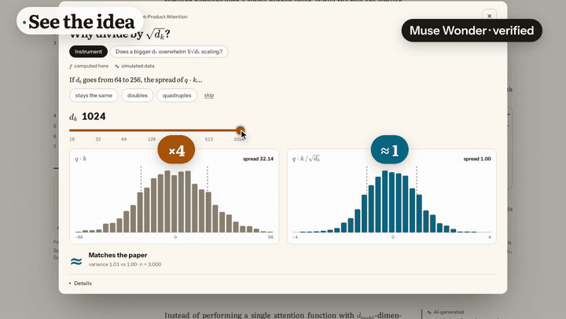
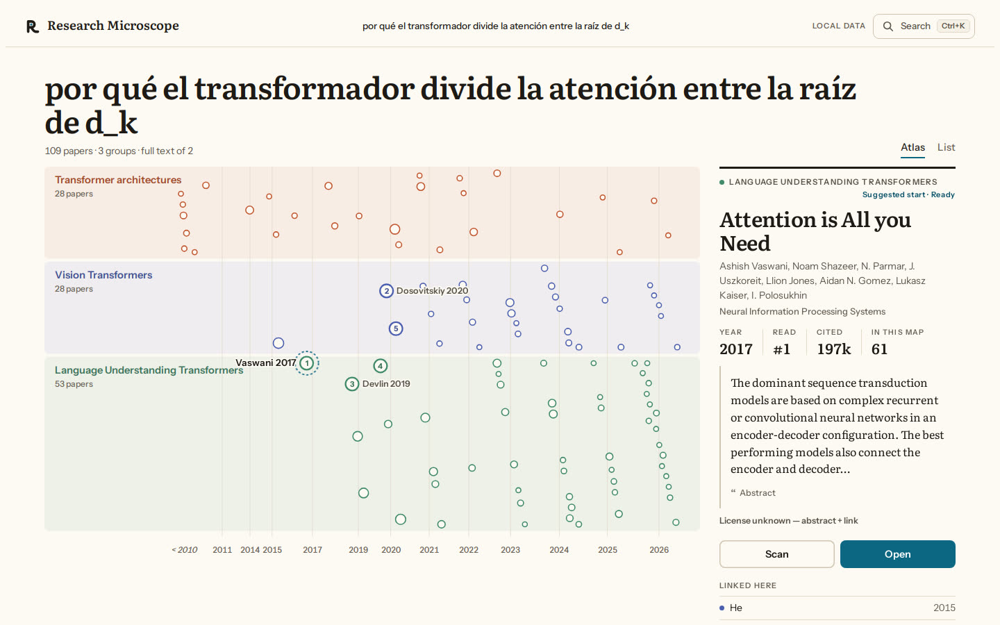
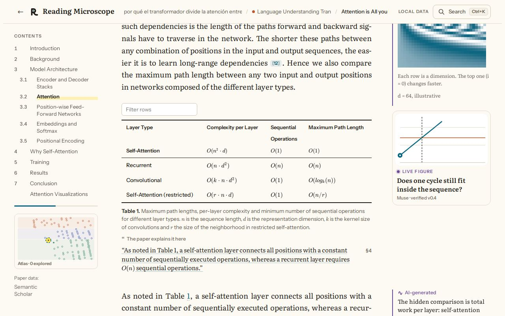
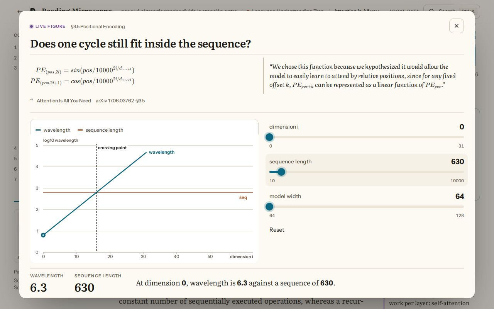
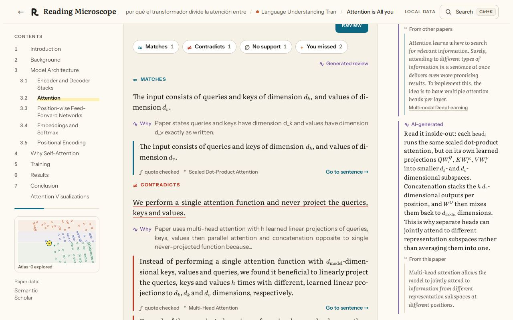
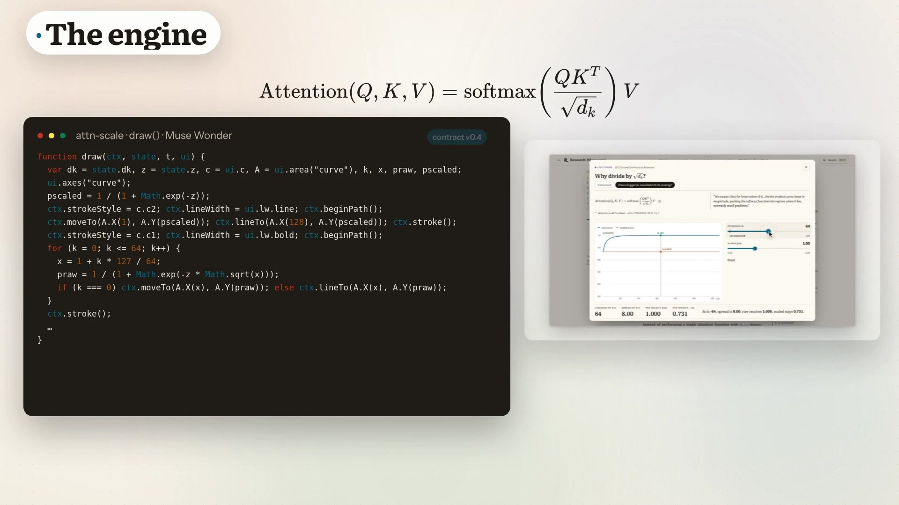
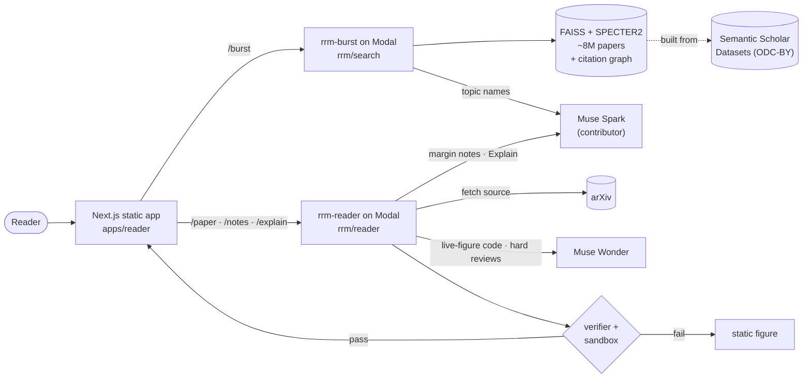

<p align="center">
  
</p>

<h1 align="center">Research Microscope</h1>

<p align="center"><b>The joy of understanding — from a field to a single idea.</b></p>

<p align="center">
  <a href="VIDEO_URL"><b>▶ Watch the 3-minute demo</b></a> ·
  <a href="#how-it-works">How it works</a> ·
  <a href="#meta-models">Meta models</a> ·
  <a href="#run-it">Run it</a> ·
  <a href="#honest-limits">Limits</a>
</p>

<p align="center">
  
</p>

Ask one research question. Research Microscope draws the field as a map of related papers, takes you into the right paper, and helps you understand it: every symbol is linked to where it's defined, margin notes cite their sources, equations become live figures you can play with, and **Explain** checks your own explanation against the paper.

## The problem

- **The volume keeps growing.** arXiv received a record **40,363** new submissions in September 2026. In September 2016 it received 9,869, so monthly volume has grown about 4× in ten years ([arXiv blog, Oct 2026](https://blog.arxiv.org/2026/10/01/updated-rate-limit-policy/)). Up to **1 in 5** Computer Science abstracts already show LLM-modified text ([Liang et al., *Nature Human Behaviour*, 2025](https://www.nature.com/articles/s41562-025-02273-8)).
- **Reading is where people get stuck.** Most researchers say they can't keep up with the literature ([arXiv:1612.07863](https://arxiv.org/abs/1612.07863)). Readers get stuck on a paper's local terms and symbols: in an observational study, 8 of 9 did ([ScholarPhi, CHI '21](https://arxiv.org/abs/2009.14237)).

Summaries make reading faster, but they don't build understanding. Research Microscope is built for understanding.

## What it does

| | |
|---|---|
<p align="center"></p>

**One question, one map.** Type a question, a title, or a topic, in English or Spanish. You get about 100 related papers, grouped into topics, laid out by year, and numbered in a suggested reading order.

| | |
|---|---|
|  |  |
| **The paper.** Symbols light up wherever they appear. Margin notes have three clearly labelled layers: *From this paper*, *From other papers*, and *AI-generated*. | **Live figures.** An equation becomes a small interactive instrument, written by Muse Wonder under a strict contract and checked before it is shown. |
|  |  |
| **Explain.** Write what you understood. Each claim comes back as *Matches*, *Contradicts*, *No support*, or *You missed*, with a quote from the paper that was checked against its text. | **The engine.** Equation → `draw()` code → a verified, sandboxed widget. |

<sub>Screenshots show *Attention Is All You Need* (Vaswani et al., 2017, [arXiv:1706.03762](https://arxiv.org/abs/1706.03762)). Google grants permission to reproduce the paper's tables and figures for scholarly use with attribution. Paper data: [Semantic Scholar](https://www.semanticscholar.org/).</sub>

## How it works



1. **Map (`rrm-burst`).** The question is embedded with SPECTER2 and searched in a FAISS index over about 8M papers from Semantic Scholar's Computer Science corpus. The search is expanded through the citation graph, the results are split into topics, and they are laid out on a timeline. `pipelines/` builds the corpus and the index on Modal.
2. **Read (`rrm-reader`).** The reader fetches the paper's arXiv source, parses it into sections, equations, symbols, and figures, and finds the gaps a newcomer would trip on. It then writes margin notes from the paper, from similar papers (a passage index of 1,842 papers and 298,623 passages), and from the model, and labels each note with where it came from.
3. **License gate.** Only CC BY, CC BY-SA, CC0, and public-domain papers are shown in full. For every other paper, the reader shows the title, authors, abstract, short quotes with attribution, and a link to arXiv. See [`/licenses`](apps/reader/src/app/licenses/page.tsx).

### The widget engine

Muse Wonder writes a single JSON object that follows the `rrm-widget` contract: `id`, `topic`, `title`, `explain`, `questions`, `controls`, and a pure `draw(ctx, state, t)` function ([contract](rrm/liveart/CONTRACT.md)). Before anything runs, a verifier checks the code's AST, the control budgets, and its fidelity to the paper. The widget then runs in a sandboxed iframe with no network access. If the check fails, the reader falls back to the static figure and never shows a half-working widget. **Today, 9 of our 11 widgets pass the verifier and the sandbox.**

### Explain

You write your explanation and Muse reviews it, claim by claim, against passages from the paper. Every quote it returns is checked against the paper's text. **On our test set of 137 hand-written claims, each run 3 times, 99% of verdicts were correct and 98% were stable.**

## Meta models

| Model | Used for | Code |
|---|---|---|
| **Muse Spark** (`muse-spark-1.3-contributor`) | Topic names on the map, margin notes, Explain reviews, the paper brief and gap candidates | `rrm/search/split.py`, `rrm/reader/notes.py`, `rrm/reader/explain/`, `rrm/reader/analysis/` |
| **Muse Wonder** (`muse-wonder-1.0`) | Live-figure code (`draw()`) and the hardest reviews | `rrm/reader/analysis/llm.py`, `rrm/reader/explain/llm.py`, `rrm/liveart/` |
| **Muse Image** (`muse-image-1.0`) | Concept art for the demo video | video pipeline |

All calls go through the Meta Model API. The reader's calls set `store: false`. Paper notes cover **86%** of what a reader must know (88% on unseen papers), and analyzing a paper costs less than 1 cent.

## Run it

**Option 1: watch it.** The [3-minute video](VIDEO_URL) shows the full flow on real papers.

**Option 2: local UI, no keys, $0.** This option runs the real UI and a local API on a small synthetic map, with no Modal, Meta, or Semantic Scholar calls. You need Python 3.12 and Node ≥ 22. The script runs `npm ci` itself the first time.

```bash
git clone https://github.com/FrankEBaru/research-microscope && cd research-microscope
RRM_OFFLINE_SYNTH=1 bash scripts/offline.sh      # open http://localhost:3000, Ctrl+C stops it
```

The synthetic data shows the flow (home → map → paper), not real papers.

**Option 3: live, with your own keys (advanced).** This needs a Modal account, `MODEL_API_KEY` (Meta Model API), and `S2_API_KEY` (Semantic Scholar), plus the corpus and index built on Modal with [`pipelines/s2_download/RUN.md`](pipelines/s2_download/RUN.md) and [`pipelines/index_build/RUN.md`](pipelines/index_build/RUN.md). Then:

```bash
RRM_MODE=online bash scripts/run.sh   # deploys rrm-burst and rrm-reader, stops them on exit
```

`RRM_MAX_MINUTES` (default 30) stops the session automatically, and the script never prints keys. The recorded real-paper data used in our demo is not published, because it contains paper text (see [Honest limits](#honest-limits)).

**Checks:** `bash scripts/check.sh` (Python; no network calls to paid services) and `cd apps/reader && npm test`.

## Repository map

| Path | What |
|---|---|
| `apps/reader/` | Next.js static app (the UI) |
| `rrm/search/` | Map service: search, citation graph, topics, layout (`rrm-burst`) |
| `rrm/reader/` | Paper service: parsing, gaps, notes, Explain, license gate (`rrm-reader`) |
| `rrm/liveart/` | Widget contract, prompts, verifier |
| `pipelines/` | Semantic Scholar download and FAISS / citation-graph build on Modal |
| `eval/`, `evals/` | Citation recall, prompt and widget evaluations |
| `scripts/` | Run, offline, checks |

## Honest limits

- **It is a demo, not a hosted service.** The live backend only runs during demos. The online mode needs your own Modal, Meta, and Semantic Scholar keys and a prebuilt index.
- **The map covers Computer Science only:** Semantic Scholar's CS subset.
- **Full text only for open licenses.** Papers under the default arXiv license, or under NC or ND licenses, show only metadata, the abstract, short quotes, and a link.
- **Widgets:** 9 of 11 pass verification. A widget that fails falls back to the static figure.
- **The Explain numbers come from our own test set** of 137 claims, not from an external benchmark.
- **Legacy features** (Panorama, the companion, the SAM figure tools, and the old instrument) are still in the code. They are off by default and only turn on with `RRM_FEATURES=all`.
- Some internal notes and code comments are still in Spanish.

## License and attribution

- Code: [MIT](LICENSE).
- Paper metadata, abstracts, citations, and SPECTER2 embeddings: **[Semantic Scholar](https://www.semanticscholar.org/)** Datasets (ODC-BY). arXiv metadata (CC0). Papers belong to their authors and keep their own licenses; this project is not endorsed by the authors or by arXiv.
- Built with [Next.js](https://nextjs.org/), [KaTeX](https://katex.org/) (MIT), [FAISS](https://github.com/facebookresearch/faiss) (MIT), [SPECTER2](https://huggingface.co/allenai/specter2) (Apache-2.0), [opus-mt-es-en](https://huggingface.co/Helsinki-NLP/opus-mt-es-en) (translates Spanish questions), [Modal](https://modal.com/), and the fonts Literata and Instrument Sans (SIL OFL 1.1). The video was made with [Remotion](https://www.remotion.dev/).
- Built for the Meta AI Developer Hackathon 2026 with Muse Spark, Muse Wonder, and Muse Image through the Meta Model API.
