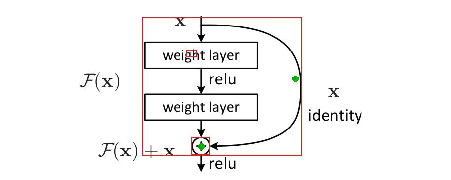
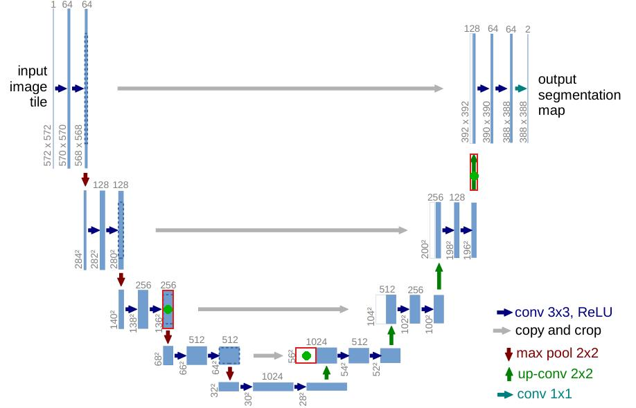
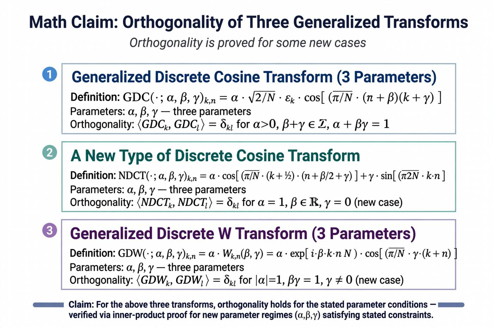

# RRM-58 — Muse Image, SAM 3.1 y el click en la figura

Análisis y pruebas mínimas. No se implementó ninguna feature. Voice quedó fuera. Modal: $0. No se descargó arXiv: se usaron los dos tarballs locales (LaTeX de 8 papers y 53 papers parseados).

**Barra de la visión.** El lector hace click en una parte de la figura y recibe una explicación de esa parte, con pasajes citados, que digiere la idea. Tiene que ser considerablemente mejor que leer el caption o el párrafo que ya menciona la figura. Si no lo es, el veredicto es no.

**Gasto Meta calculado: $0.0427585.** La API no devolvió dólares. El número es la tarifa publicada el 2 nov 2026 aplicada a tokens e imágenes medidos. Tope $0.30. Detalle al final.

## Precios y endpoints (doc real, 2 nov 2026)

Leído en [Pricing and rate limits](https://dev.meta.ai/docs/pricing-rate-limits), [Models](https://dev.meta.ai/docs/models), [Media segmentation](https://dev.meta.ai/docs/media-segmentation) e [Image generation](https://dev.meta.ai/docs/image-generation).

| Herramienta | Id | Endpoint | Precio |
|---|---|---|---|
| SAM 3.1 | `sam-3.1` | `POST /v1/responses` | $2.50 / 1000 imágenes ($0.0025). Video $0.20 / 1000 frames, mínimo 50. No se usó video. |
| Muse Spark contributor | `muse-spark-1.3-contributor` | el mismo `/v1/responses` | entrada $0.10 / 1M, caché $0.002 / 1M, salida $0.20 / 1M |
| Muse Spark standard | `muse-spark-1.3` | el mismo | entrada $1.25 / 1M, salida $4.25 / 1M. No se llamó. |
| Muse Wonder | `muse-wonder-1.0` | el mismo. Solo standard | entrada $4 / 1M, caché $0.20 / 1M, salida $20 / 1M |
| Muse Image | `muse-image-1.0` | `POST /v1/images/generations` (también `/v1/images/edits` y `/v1/responses`) | $0.01 por imagen devuelta. La búsqueda propia va incluida. Los tokens del `usage` no se cobran. |
| Muse Code | no es un modelo | producto (IDE), no un endpoint del lector | — |
| Muse Spark Open, Muse Glimmer | pesos abiertos | sin endpoint en la API | correrlos exigiría GPU. Modal estaba en $0, no se probaron. |

Un prompt de puntos de SAM y un sustantivo no se pueden mandar juntos. Un click es `<0f>1<|point;x=;y=;w=;h=|>`. Hasta 16 objetos por imagen, y se cobra la imagen, no el objeto. `web_search` en texto cuesta $2.50 / 1000 búsquedas aparte. No se usó.

## Qué hay en las figuras, sin modelo

De 55 PDF de figura en los 8 fuentes (sin las rejillas de fotos de ejemplo): **36 con texto vectorial, 6 raster, 13 vectoriales mudos** [V]. Los 12 `tikzpicture` están todos en DANN [V]. El bloque residual y la U-Net son vector con texto: 13 palabras y 81 palabras [V].

El diagrama principal de DANN (`deepDA2.pdf`) es un PowerPoint sin fuentes y sin palabras (`pdftotext` vacío) [V]. Las etiquetas que el ojo lee están dibujadas como trazos. Tesseract local saca pedazos (`feature extractor`, `domain Qessificr`).

Eso parte la visión en dos: nombrar la zona, y explicar esa zona.

## La prueba, lado a lado

Clicks en coordenadas del PDF, no en la leyenda. Scripts: `scripts/research/rrm58_probe.py` y `scripts/research/rrm58_follow.py`. Salidas en `docs/research/rrm58/`.

### ResNet, atajo identidad (`eps/block.pdf`)

Caption, entero: «Residual learning: a building block.»

El párrafo que está con la figura (`206594692:28`) ya dice la operación: para el ejemplo de la figura, \(\mathcal{F}=W_2\sigma(W_1\mathbf{x})\), \(\sigma\) es ReLU, y \(\mathcal{F}+\mathbf{x}\) es el atajo con suma elemento a elemento; la segunda no linealidad va después de la suma.

La palabra más cercana al click en la curva fue `identity` [V]. Spark, con la etiqueta `identity` y todos los párrafos del paper, devolvió tres citas literales de `206594692:10` (el intro, no el :28) y `"beyond": false`: el caption y los pasajes que citan la figura ya lo dicen [V]. Las tres citas están copiadas tal cual [V]. El texto que armó («passing x through unchanged») es un parafraseo de «identity mapping». No llega al detalle de :28 (dos capas, ReLU, suma).

El click en el círculo \(+\) tiene como palabra más cercana `relu`. El `+` escrito es la cuarta palabra [V]. Ahí el texto del PDF nombra mal.

### U-Net, flecha verde de up-conv

Caption: cada caja azul es un mapa de features, los números son canales y tamaño, las cajas blancas son mapas copiados, las flechas son las operaciones. No dice qué hace un up-conv.

La palabra más cercana al click en la flecha verde fue `128` [V]. El color del pixel es `(0, 127, 0)`, el mismo verde `(0, 0.5, 0)` del trazo de la leyenda que está junto a las palabras `up-conv` `2x2` [V]. Con el color, el código llega al nombre. Con la palabra más cercana, no.

El párrafo de arquitectura (`3719281:15`) ya lo define en una oración: cada paso del camino expansivo es un upsampling, luego una convolución 2x2 («up-convolution») que parte a la mitad los canales, concatena el mapa recortado, y dos convoluciones 3x3 con ReLU.

Spark citó esa oración (y también `3719281:8`, que habla del FCN previo: «pooling operators are replaced by upsampling operators») y puso `"beyond": false` [V]. Wonder, el mismo prompt, citó solo la oración de :15 y también `"beyond": false` [V]. Las citas son literales [V]. Ninguno dijo algo que el párrafo no diga. Spark se dejó fuera el recorte y la concatenación, que son la mitad siguiente de la misma oración.

Verde: el click. Rojo: la caja de SAM. El atajo salió como un rectángulo que se come las dos capas (confianza 0.28). El \(+\) sí quedó ceñido (0.79). El click en «weight layer» salió un cuadrito en el borde (0.24), no la caja.

Las tres cajas de U-Net sí ciñen la flecha verde, la caja blanca y una barra azul. SAM aísla la forma. No dice que la verde es un up-conv.

## Propuestas

### 1. Click → explicación citada (la visión)

- **Duda.** «¿Qué es esta parte?» sin leerse el párrafo.
- **Flujo.** Código: palabra del PDF o color de la leyenda. Código: párrafos que citan esa figura. Modelo, si acaso: Spark reescribe. En la prueba el modelo no aportó una frase que el párrafo no tuviera.
- **Prueba.** Las dos figuras de arriba, más el \(+\). Spark y Wonder dijeron `beyond=false`.
- **Calidad [V].** La explicación fiel es una oración que ya está junto a la figura. En ResNet, Spark citó el intro y se saltó la definición más precisa. En U-Net, la oración de :15 es mejor que el caption y no es mejor que leer :15.
- **Costo y latencia.** Spark contributor: $0.0006929 en 11.27 s (ResNet, 6021+454 tokens) y $0.0004982 en 6.99 s (U-Net, 3824+579) [V]. Por paper, si cada click llama al modelo, son ~7–11 s: no se siente como un click. Precalcular es guardar la misma oración.
- **Riesgo.** Parafraseo que suena a cita. Contributor mode puede usar el prompt para entrenar; aquí el texto es público.
- **Veredicto: no vale.** No es considerablemente mejor que el párrafo. Estimación si aun así se construye: ~400 líneas [I]. No la haría.

### 2. SAM 3.1 para la región del click

- **Duda.** «¿Cuál es el contorno de lo que toqué?»
- **Flujo.** Un `POST /v1/responses` con `sam-3.1` y puntos. El nombre sigue siendo código (texto o color) o un VLM.
- **Prueba.** Una imagen con 3 puntos en ResNet y otra con 3 en U-Net. Aparte, el sustantivo `arrow` en cada figura. Ver las dos imágenes de arriba y `rrm58/resnet_arrows.jpg`.
- **Calidad [V].** U-Net: 3/3 cajas ceñidas, confianza 0.89, 0.82, 0.93. ResNet: el \(+\) sí (0.79); el atajo no (caja enorme, 0.28); la capa de pesos no (cuadrito, 0.24). `arrow` devolvió 36 cajas en U-Net y 5 en ResNet: todas las flechas, no la del click.
- **Costo y latencia.** $0.0025 por imagen [I, tarifa × 1 imagen]. Medido: 1.71 s, 1.50 s, 1.80 s, 0.60 s [V]. Por figura de arquitectura, una llamada, aunque haya varios puntos.
- **Riesgo.** Una caja grande con poca confianza parece «la región» y no lo es. En dibujo de líneas el sustantivo no distingue el rol (up-conv vs conv vs pool).
- **Veredicto: no vale** para entender. Aísla algunas formas y no explica. El recorte de página que ya hace el lector es otro trabajo. Estimación: ~120 líneas encima de `rrm/reader/sam.py` [I].

### 3. Spark o Wonder para escoger el pasaje

- **Duda.** El código con palabras sueltas, sobre todo el paper, agarra el párrafo equivocado.
- **Flujo.** Todo el texto al modelo, contra buscar solo dentro de los párrafos que citan la figura.
- **Prueba.** El overlap de palabras en todo ResNet, para el click `identity`, rankeó primero `206594692:33` [V]. Ese párrafo cita `fig:block_deeper` y la ecuación `eq:identity`. `fig:block` es prefijo de `fig:block_deeper`, así que un `in` de Python también lo mezcla [V]. Spark, con el paper entero, sí eligió :10, que es un párrafo del atajo. No eligió :28, que es el mejor.
- **Calidad [V].** Acotar a la figura y exigir la palabra de la leyenda (`up-conv` → `up-convolution`, `identity` dentro de :10) llega a la misma cita sin modelo. Wonder no eligió mejor que Spark: una cita, la de :15.
- **Costo.** Wonder $0.021116 en 2.62 s, contra $0.0004982 de Spark en el mismo prompt: unas 42 veces más [V]. Los dos con `beyond=false`.
- **Riesgo.** El modelo cita la mitad de la oración y el lector cree que ya está.
- **Veredicto: no vale.** El vínculo lo hace el código si el nombre de la parte es el de la leyenda. Estimación del resaltado: ~300 líneas [I]. Sigue sin superar al párrafo, así que tampoco lo construiría como explicación.

### 4. Visión de Spark cuando el texto cercano miente

- **Duda.** El click en el \(+\) cae más cerca de `relu`.
- **Flujo.** Imagen con un punto verde, sin decirle la palabra. Spark ve el dibujo.
- **Prueba.** Punto en el círculo del bloque. Respuesta: `"name": "addition"`, y la frase dice que el círculo suma \(\mathcal{F}(x)\) con el atajo antes del relu. `"beyond_caption": false` [V]. El caption de una línea no dice eso; el dibujo sí. El modelo leyó el dibujo, que el lector también está viendo.
- **Otra llamada.** Punto verde en \(L_d\) del diagrama mudo de DANN, con pasajes. `output_tokens` 500, de ellos 498 de razonamiento, texto visible vacío [V]. No se reintentó. No hay juicio de calidad ahí. Costo igual: $0.0003418, 7.07 s.
- **Costo.** La del \(+\): $0.0001096, 4.57 s, 484+306 tokens [V].
- **Riesgo.** Nombrar de memoria un símbolo que el dibujo no sostiene. Aquí el \(+\) sí está dibujado.
- **Veredicto: solo demo.** Acierta el nombre donde el vecino de texto falla, y no explica mejor que la figura ni que el párrafo. ~100 líneas [I].

### 5. Muse Image cuando el paper no trae figura

- **Duda.** El DCT (1195959) no tiene figuras. ¿Un esquema ayuda?
- **Flujo.** `POST /v1/images/generations`, `muse-image-1.0`, `reasoning_strength: low`, búsqueda web, búsqueda de imágenes y shell apagados. El prompt solo repetía el abstract: DCT generalizada con tres parámetros, un tipo nuevo, W generalizada con tres parámetros, ortogonalidad en algunos casos nuevos.
- **Prueba.** Una imagen, 12.80 s, status 200 [V]. Abajo, el jpg.

- **Calidad [V].** El paper usa parámetros \(p, q, r\) y ortogonalidad cuando \(\gcd(pq,N)=1\) y \(\gcd(pr,2)=1\). La W añade \(\gamma\) y es ortogonal en casos como \((\alpha,\beta,\gamma)=(\tfrac{1}{2}, r/q, 2pq)\). La imagen inventa nombres (GDC, NDCT, GDW) y condiciones (\(\alpha>0\), \(\beta+\gamma\in\mathbb{Z}\), \(\alpha+\beta\gamma=1\), \(|\alpha|=1\), \(\beta\gamma=1\)) que no están en el paper. Se ve como un apunte y está mal.
- **Costo.** $0.01 por la imagen devuelta [I, tarifa]. El `usage` trajo 4066+1357 tokens y no se cobran. Por paper sin figura: $0.01 y ~13 s, una vez.
- **Riesgo.** Alto. Fórmulas falsas con tipografía de teorema.
- **Veredicto: no vale.** ~80 líneas [I]. No la haría.

### 6. Muse Code y pesos abiertos

- **Duda.** ¿Bajan el costo o leen la figura mejor?
- **Flujo.** Muse Code no tiene un id de modelo para el lector: es el producto donde corren Wonder y Spark. Spark Open y Glimmer se sirven aparte. La doc lo dice así. No hay llamada que hacer sin GPU, y Modal estaba en $0.
- **Prueba.** No se probaron. La razón es de disponibilidad, no un resultado inventado.
- **Veredicto: no vale** para esta visión. Aunque corrieran, el techo es el mismo párrafo: un modelo más barato no crea una explicación que el texto no tiene. 0 líneas en este repo.

## Ranking por beneficio neto

Neto = lo que el lector gana sobre el caption y el párrafo, menos costo, latencia y alucinación.

1. **No construir la visión.** El párrafo de al lado ya es la explicación. Es el resultado con mejor neto.
2. **Código de leyenda (texto o color) → esa oración**, si algún día se quiere un resaltado. $0, instantáneo, no inventa. Contra la barra: **no vale**. Es lo menos malo de lo que sí se podría programar.
3. **Visión de Spark para un símbolo suelto.** **Solo demo.**
4. **SAM por puntos.** **No vale.** Útil a medias para el contorno, inútil para el significado.
5. **Spark para redactar.** **No vale.** Barato y lento, y repite el párrafo.
6. **Wonder para redactar.** **No vale.** Lo mismo, ~42× el precio de Spark en la llamada que se comparó.
7. **SAM por sustantivo (`arrow`).** **No vale.** Encuentra la clase, no la parte.
8. **Muse Image para inventar el esquema que falta.** **No vale.** Resta: el dibujo miente.
9. **Muse Code y pesos abiertos.** **No vale.** No entran al lector con este presupuesto.

## Costo

Tarifa del 2 nov 2026 × uso medido. Ninguna respuesta trajo un campo de dólares. Caché de entrada: 0 en todas.

| Llamada | Modelo | Tiempo | Uso medido | USD |
|---|---|---|---|---|
| sam_points_resnet | sam-3.1 | 1.706 s | 1 imagen, 3 cajas | 0.00250000 |
| sam_points_unet | sam-3.1 | 1.499 s | 1 imagen, 3 cajas | 0.00250000 |
| sam_concept_unet_arrow | sam-3.1 | 1.797 s | 1 imagen, 36 cajas | 0.00250000 |
| sam_concept_resnet_arrow | sam-3.1 | 0.601 s | 1 imagen, 5 cajas | 0.00250000 |
| spark_resnet_shortcut | muse-spark-1.3-contributor | 11.270 s | 6021 + 454 tokens | 0.00069290 |
| spark_unet_upconv | muse-spark-1.3-contributor | 6.990 s | 3824 + 579 tokens | 0.00049820 |
| wonder_unet_upconv | muse-wonder-1.0 | 2.619 s | 3824 + 291 tokens | 0.02111600 |
| spark_vision_resnet_plus | muse-spark-1.3-contributor | 4.573 s | 484 + 306 tokens | 0.00010960 |
| spark_vision_dann_loss | muse-spark-1.3-contributor | 7.065 s | 2418 + 500 tokens, texto vacío | 0.00034180 |
| muse_image_dct | muse-image-1.0 | 12.797 s | 1 imagen | 0.01000000 |
| **Total** | | | | **0.04275850** |

Modal: $0. No se encendió ninguna app. Voice: no se llamó.
